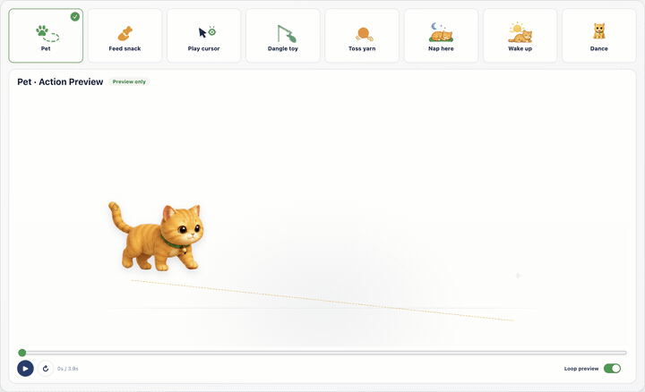
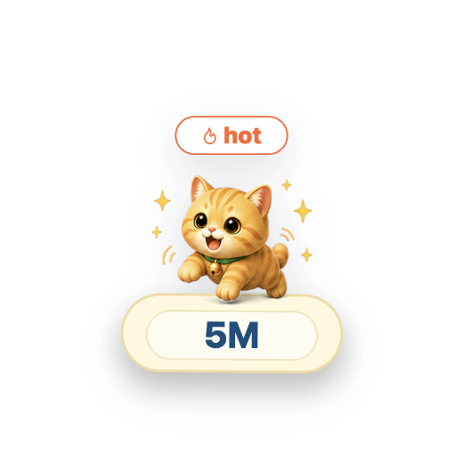
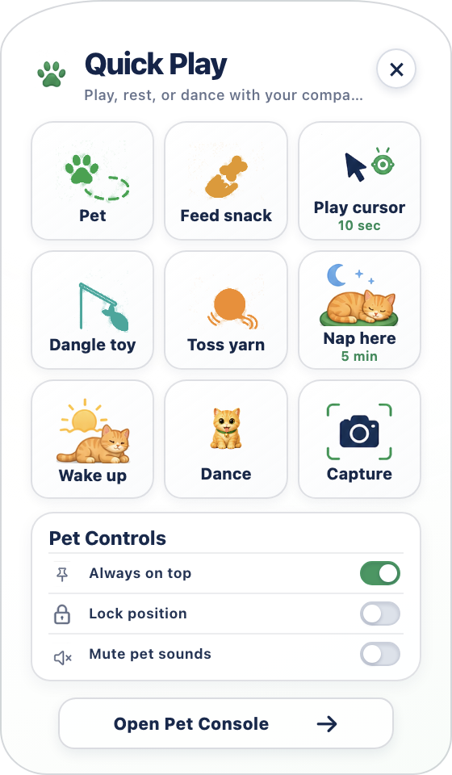
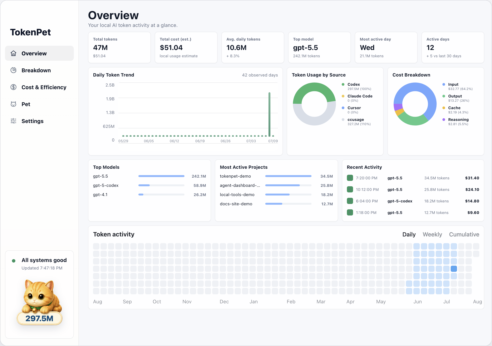
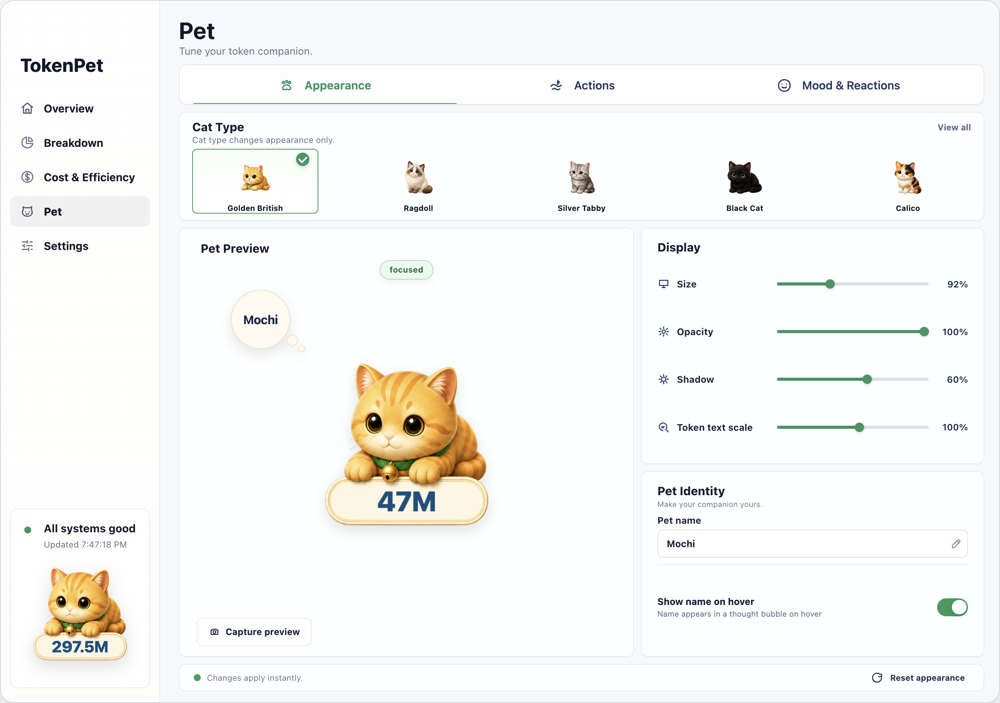
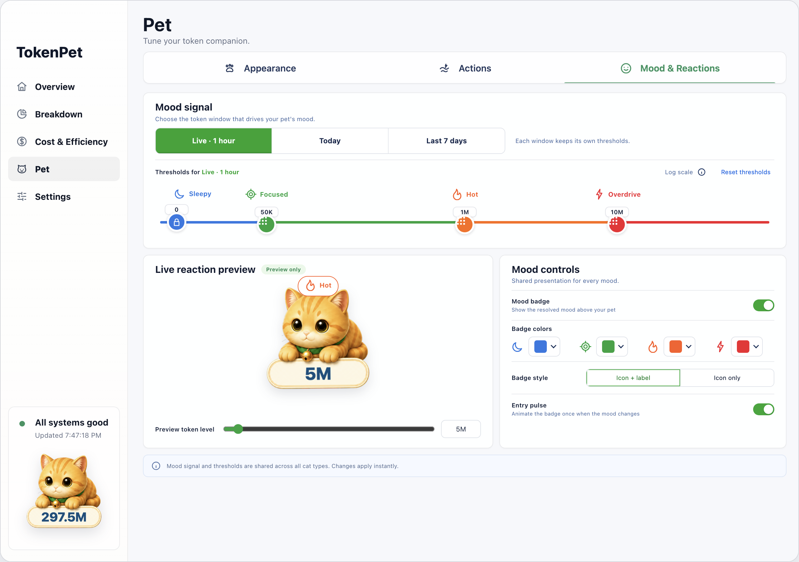

# TokenPet

### Your AI token usage, living on your desktop.

TokenPet is a local-first macOS companion that turns AI coding activity into a tiny cat with moods, movement, and personality. It was inspired by the small rituals of living with a real cat: the curious stare at a moving cursor, the sudden sprint across a room, the long nap beside your work, and the quiet habit of simply being there.

Instead of leaving token usage buried in logs, TokenPet makes it glanceable and playful—right from the menu bar, the desktop, or a focused local console.

<p align="center">
  
</p>

## A companion, not another dashboard

- **Lives on the desktop.** The cat stays visible on the current macOS Space and keeps its token total close at hand.
- **Reacts to real local usage.** Sleepy, Focused, Hot, and Overdrive moods follow the token window you choose.
- **Plays like a pet.** Eight authored actions use offline animation assets and action-specific choreography—not a static image sliding across the screen.
- **Stays out of the way.** Size, opacity, shadow, name, always-on-top behavior, and motion preferences are under your control.
- **Keeps data local.** TokenPet does not require an account or upload prompts, code, paths, or session content.

## Meet TokenPet

<table>
  <tr>
    <td align="center" width="50%">
      
      <br /><strong>Always nearby</strong><br />A compact desktop companion driven by local token activity.
    </td>
    <td align="center" width="50%">
      
      <br /><strong>Double-click to play</strong><br />Open Quick Play without leaving the app you are working in.
    </td>
  </tr>
</table>

## Eight ways to play

| Action | What happens |
| --- | --- |
| **Pet** | The cat chooses a destination, walks there with direction-aware steps, looks around, and returns. |
| **Feed snack** | Place a treat and watch the cat approach, lick, bite, chew, swallow, and head back. |
| **Play cursor** | For 10 seconds, the cat follows the cursor with its eyes, head, and ears. |
| **Dangle toy** | Turn the pointer into a fish teaser and invite an alert, stalk, pounce, and chase. |
| **Toss yarn** | Throw a yarn ball for the cat to chase, collect, carry, and drop. |
| **Nap here** | Settle the cat into a five-minute nap with its token bubble still visible. |
| **Wake up** | Wake the companion with a full-body stretch sequence. |
| **Dance** | Play the fixed-anchor Golden British dance loop. |

The showcase above is generated from the real Actions Preview renderer. Each action is sampled across its complete source timeline, so long routines remain visible inside the 19.2-second loop.

## See the activity behind the pet

The local console turns raw usage into a readable overview: daily token trends, model and project activity, estimated cost, source breakdowns, and a GitHub-style activity view.

<p align="center">
  
</p>

## Make it yours

Appearance controls apply immediately, while Mood & Reactions lets you choose whether the last hour, today, or the last seven days drives the companion. The preview is a safe stage for trying thresholds and badge presentation before returning to the desktop.

<table>
  <tr>
    <td align="center" width="50%">
      
      <br /><strong>Appearance</strong>
    </td>
    <td align="center" width="50%">
      
      <br /><strong>Mood &amp; Reactions</strong>
    </td>
  </tr>
</table>

## Install from source

TokenPet currently targets macOS and requires Node.js 18.20 or newer.

```bash
git clone https://github.com/NOTHINGYL/tokenpet.git
cd tokenpet
npm ci
npm run launch
```

`npm run launch` builds the local actor assets and app, then opens TokenPet. On subsequent launches the desktop pet appears on the Space you are currently using.

Once it is running:

1. Double-click the desktop cat to open Quick Play.
2. Use the menu bar item to open the token overview.
3. Open **Pet** in the console to adjust Appearance, Actions, and Mood & Reactions.
4. Click the desktop cat’s close control to hide it; use **Show pet** from the menu bar to bring it back on the current Space.

## Local-first by design

TokenPet reads locally available usage metadata through its bundled usage adapter and stores pet preferences on the machine. It does not need a TokenPet account, and it does not send prompts, code, file paths, or session content to a TokenPet service. Captured pet moments are written locally.

## Development

TokenPet is built with Electron, React, and TypeScript.

```bash
npm run typecheck
npm run build
npm run qa:pet-story
```

Regenerate and validate the public README media from the production renderer with synthetic local demo data:

```bash
npm run capture:readme
npm run verify:readme
```

The export manifest at [`docs/readme/manifest.json`](./docs/readme/manifest.json) records the source surface, dimensions, hashes, GIF timing, and all eight action segments. No private usage data is used in these assets.

## Contributing

Issues and focused pull requests are welcome. Please read the [contribution guidelines](./CONTRIBUTING.md) before proposing a change, and use the [security policy](./SECURITY.md) for private vulnerability reports. If TokenPet makes local AI usage feel a little more alive, consider starring the repository—it helps more people discover the project.

## License

[MIT](./LICENSE)
